# MT1 LAB EXAMINATION: Library Book Management Web Application

**Subject:** Full Stack Development – Node.js Lab Examination  
**Technology:** Node.js, HTTP Module, FS Module, Express.js  
**Database:** In-memory JavaScript Array  
**GitHub Profile:** [https://github.com/Akriti-Tyagi-2006](https://github.com/Akriti-Tyagi-2006)  
**Repository:** [https://github.com/Akriti-Tyagi-2006/MT1-LABEXAM](https://github.com/Akriti-Tyagi-2006/MT1-LABEXAM)

---

## 1. Project Overview

This project implements a complete Library Book Management Web Application divided into two independent modules:
- **Part A (`httpServer.js`)**: Built using native Node.js `http` and `fs` modules on **port 3000**. Handles custom routing, HTTP GET and POST methods, static file serving via the FS module, and error handling.
- **Part B (`expressApp.js`)**: Built using `Express.js` on **port 4000**. Implements a RESTful API supporting full CRUD operations (GET, POST, PUT, DELETE) on book records with JSON responses and HTTP status codes.

---

## 2. Project Structure

```
MT1-LABEXAM/
│
├── package.json            # Node.js project configuration (ES Modules & dependencies)
├── package-lock.json       # Dependency lockfile
├── .gitignore              # Git ignore rules for node_modules and logs
├── httpServer.js           # Part A: Native HTTP & FS Server (Port 3000)
├── expressApp.js           # Part B: Express.js REST API (Port 4000)
├── generate-screenshots.js # Automated screenshot capture script
├── public/
│   └── index.html          # Static HTML page served by FS module at /home
├── screenshots/            # Submission screenshots
│   ├── 01_http_server_terminal.png
│   ├── 02_http_server_welcome.png
│   ├── 03_static_file_fs_home.png
│   ├── 04_http_server_books_json.png
│   ├── 05_http_server_about.png
│   ├── 06_express_server_terminal.png
│   ├── 07_echoapi_get_all_books.png
│   ├── 08_echoapi_get_book_by_id.png
│   ├── 09_echoapi_post_add_book.png
│   ├── 10_echoapi_put_update_book.png
│   ├── 11_echoapi_delete_book.png
│   ├── 12_github_commit_history.png
│   └── README.md
└── README.md               # Detailed project documentation
```

---

## 3. Installation & Setup

1. **Clone the repository:**
   ```bash
   git clone https://github.com/Akriti-Tyagi-2006/MT1-LABEXAM.git
   cd MT1-LABEXAM
   ```

2. **Install dependencies:**
   ```bash
   npm install
   ```

---

## 4. Part A: Built-in HTTP and FS Module Server

### Running Part A:
```bash
node httpServer.js
```
*Expected Output:*
```
HTTP Server running at http://localhost:3000
```

### Endpoints (Port 3000):

| Method | Endpoint | Expected Response | Description |
|---|---|---|---|
| `GET` | `/` | HTML format | Displays a welcome message and links to available routes |
| `GET` | `/books` | JSON format | Returns an array of all available books |
| `GET` | `/about` | HTML format | Displays library application and developer information |
| `GET` | `/home` | HTML format | Serves the static `public/index.html` file using the `fs` module |
| `POST` | `/add-book` | JSON format | Accepts book details (`id`, `title`, `author`, `price`), validates fields, and adds the book to the array |
| *Any* | `/*` | JSON format | Returns HTTP `404 Not Found` for invalid routes |

#### Sample POST Request (`/add-book`):
- **URL:** `http://localhost:3000/add-book`
- **Headers:** `Content-Type: application/json`
- **Request Body:**
  ```json
  {
    "id": 4,
    "title": "Clean Code",
    "author": "Robert C. Martin",
    "price": 550
  }
  ```
- **Response (201 Created):**
  ```json
  {
    "message": "Book added successfully",
    "book": {
      "id": 4,
      "title": "Clean Code",
      "author": "Robert C. Martin",
      "price": 550
    }
  }
  ```

---

## 5. Part B: Express.js REST API

### Running Part B:
```bash
node expressApp.js
```
*Expected Output:*
```
Express Server running at http://localhost:4000
```

### Endpoints (Port 4000):

| Method | Endpoint | Functionality | Status Code |
|---|---|---|---|
| `GET` | `/books` | Retrieve all books | `200 OK` |
| `GET` | `/books/:id` | Retrieve a single book by ID | `200 OK` / `404 Not Found` |
| `POST` | `/books` | Add a new book record | `201 Created` / `400 Bad Request` |
| `PUT` | `/books/:id` | Update book details by ID | `200 OK` / `404 Not Found` |
| `DELETE` | `/books/:id` | Delete a book record by ID | `200 OK` / `404 Not Found` |

### Sample Book Object Structure:
```json
{
  "id": 1,
  "title": "The Alchemist",
  "author": "Paulo Coelho",
  "price": 350,
  "category": "Fiction"
}
```

---

## 6. Screenshots & Submission Verification

### 6.1 HTTP Server Running (Port 3000)
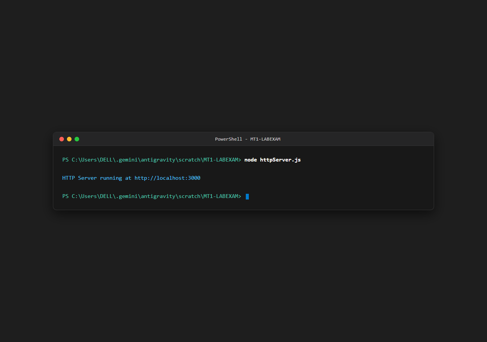

### 6.2 Static File Serving Using FS Module (`/home`)
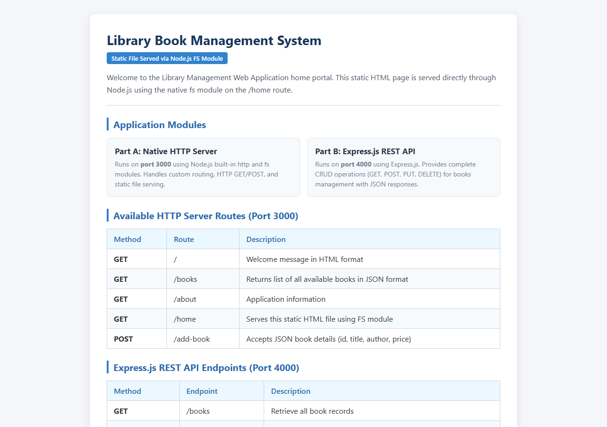

### 6.3 HTTP Server Welcome Page (`/`)
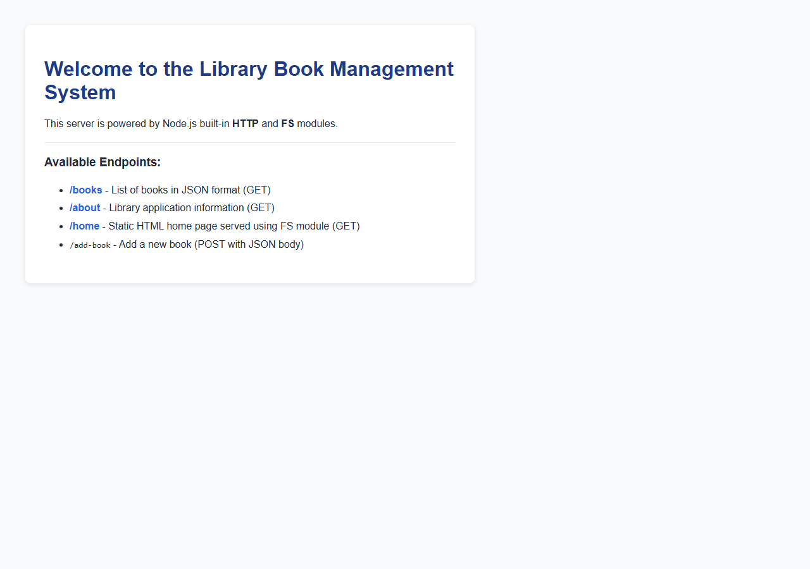

### 6.4 HTTP Server Books List (`/books`)
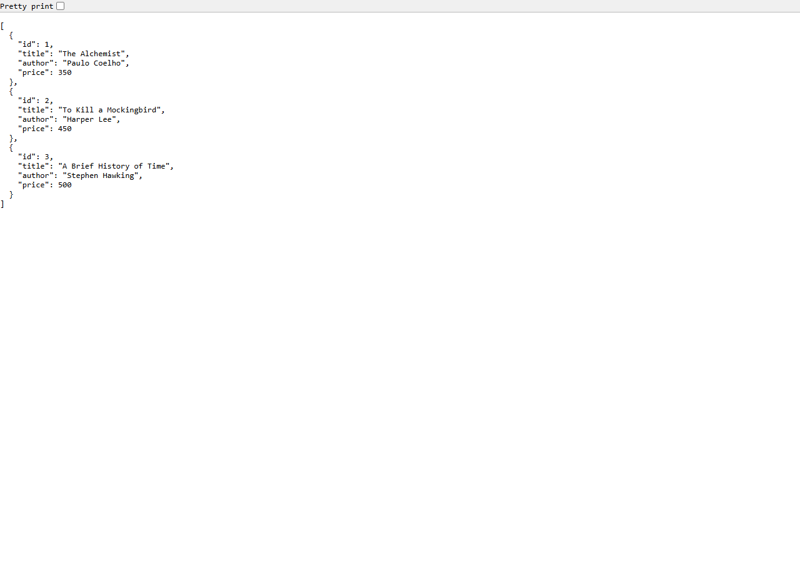

### 6.5 Express Server Running (Port 4000)
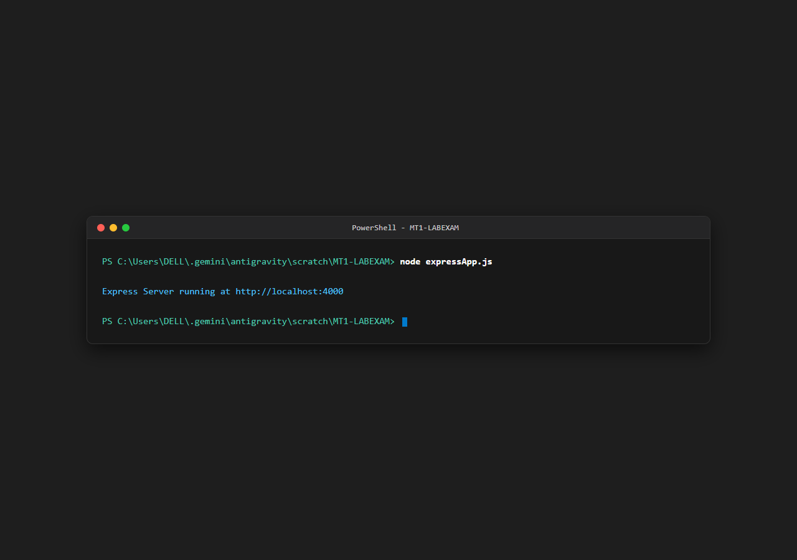

### 6.6 EchoAPI: GET All Books (`GET /books`)
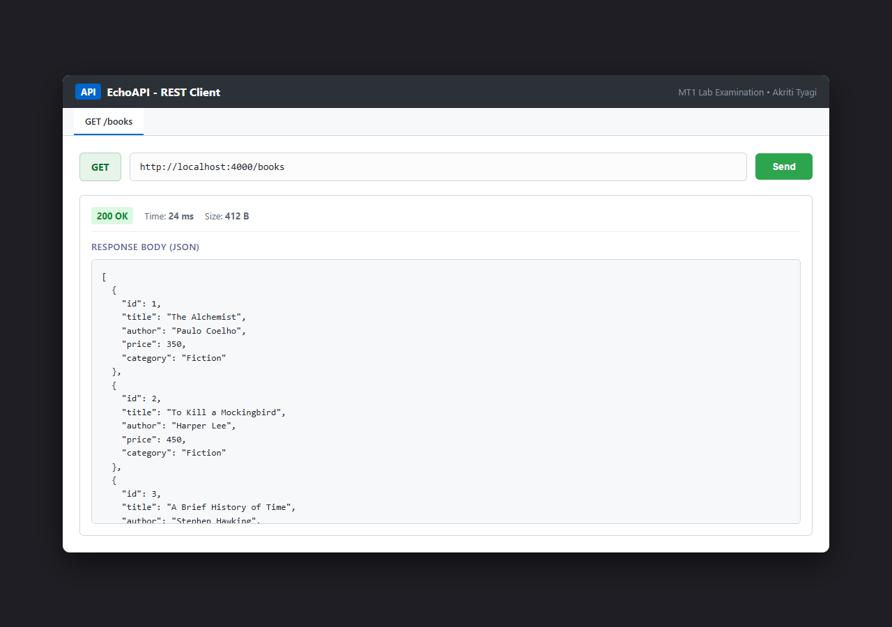

### 6.7 EchoAPI: GET Book by ID (`GET /books/1`)
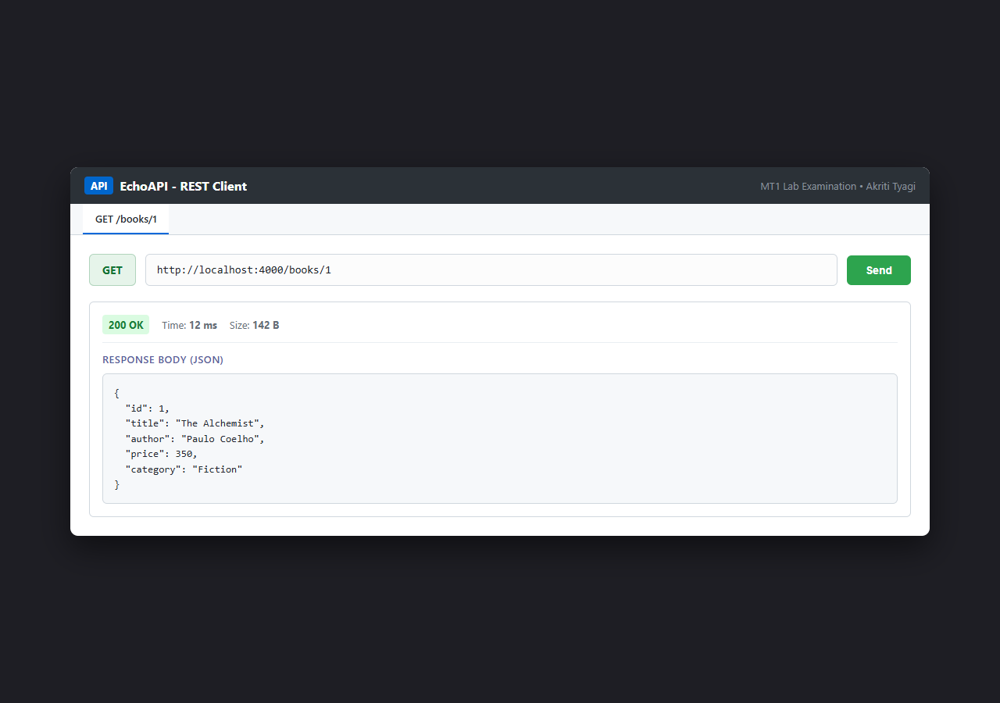

### 6.8 EchoAPI: POST Add Book (`POST /books`)
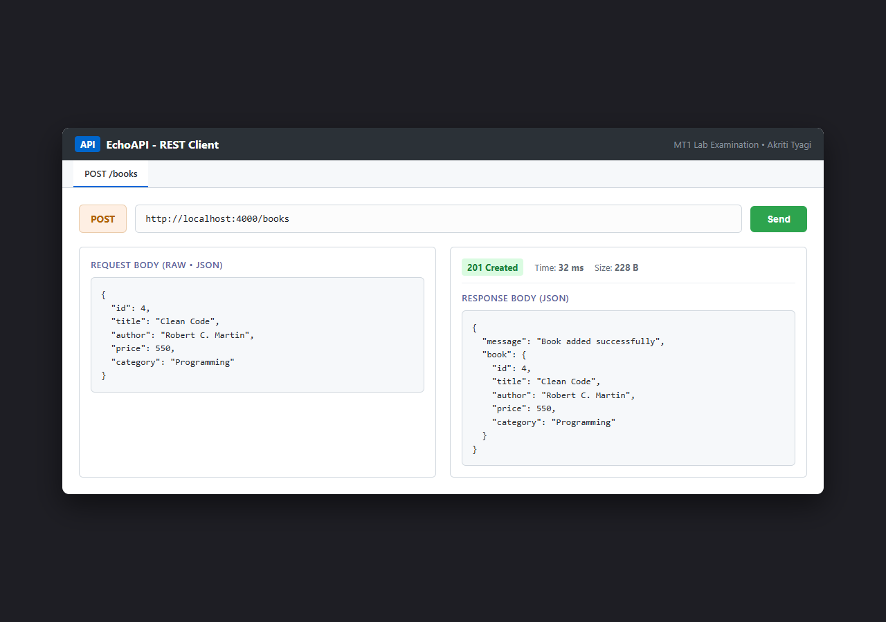

### 6.9 EchoAPI: PUT Update Book (`PUT /books/1`)
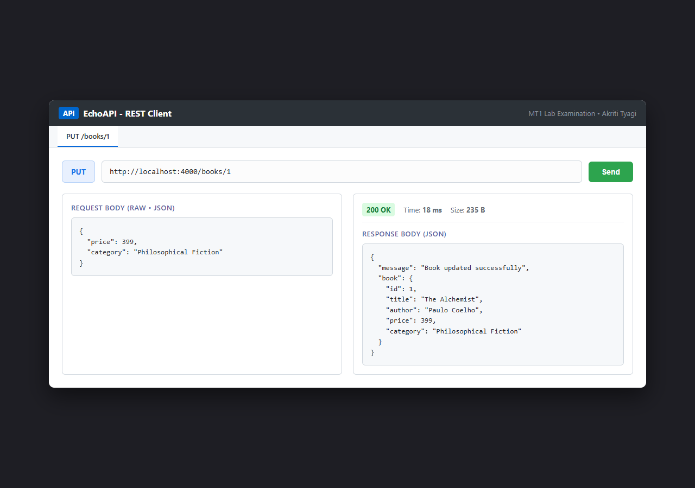

### 6.10 EchoAPI: DELETE Book (`DELETE /books/1`)
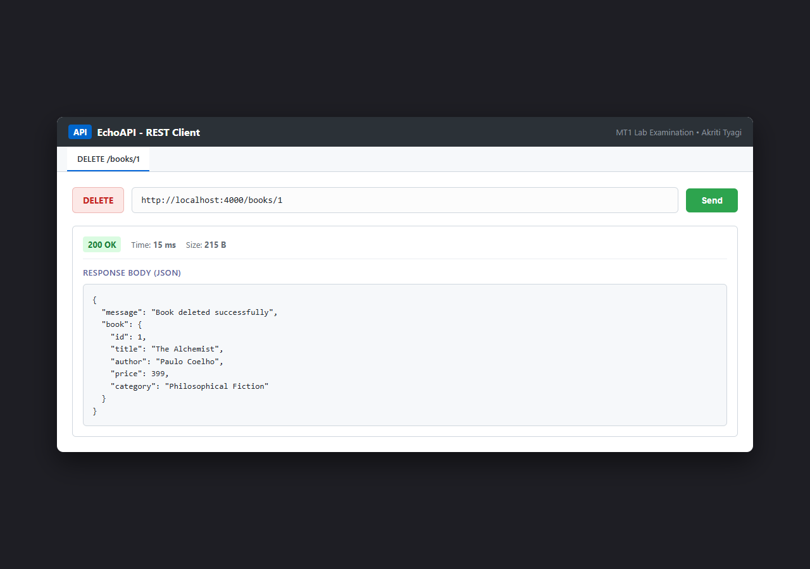

### 6.11 GitHub Commit History
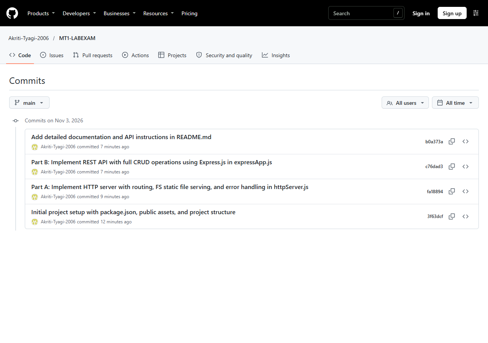

---

## 7. Commit History

1. `Initial project setup with package.json, public assets, and project structure`
2. `Part A: Implement HTTP server with routing, FS static file serving, and error handling in httpServer.js`
3. `Part B: Implement REST API with full CRUD operations using Express.js in expressApp.js`
4. `Add detailed documentation and API instructions in README.md`
5. `Add actual submission screenshots for HTTP server, FS static file, EchoAPI operations, and commit history`
