# MT1 Lab Examination Screenshots

This folder contains all verification and demonstration screenshots required by the MT1 Lab Examination submission guidelines.

---

## 1. HTTP Server Running Successfully (Part A)
*Demonstrates starting the native HTTP server using `node httpServer.js` listening on Port 3000.*

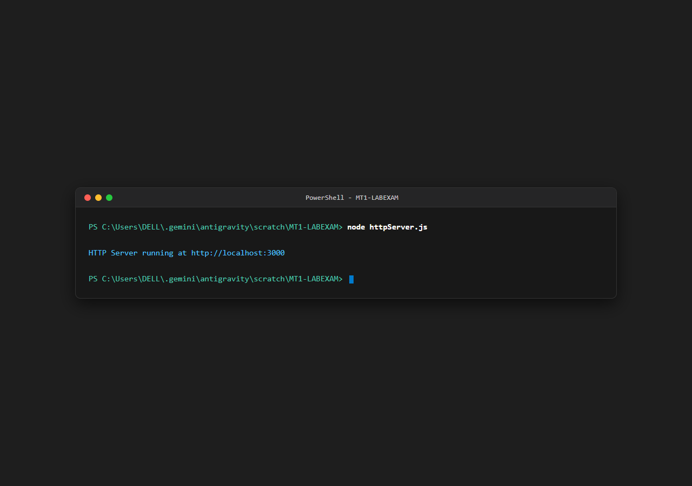

---

## 2. HTTP Server Welcome Page
*Demonstrates accessing `http://localhost:3000/` returning a welcome HTML message.*

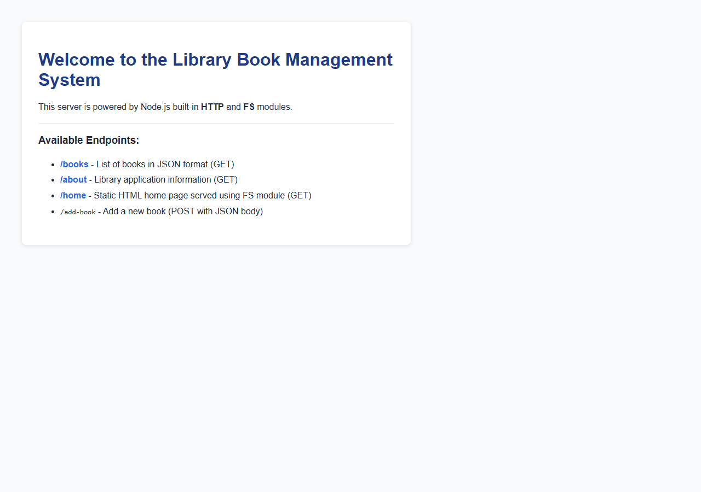

---

## 3. Static File Serving Using FS Module (Requirement A4)
*Demonstrates serving `index.html` from the `public` directory using the native `fs` module when accessing `http://localhost:3000/home`.*

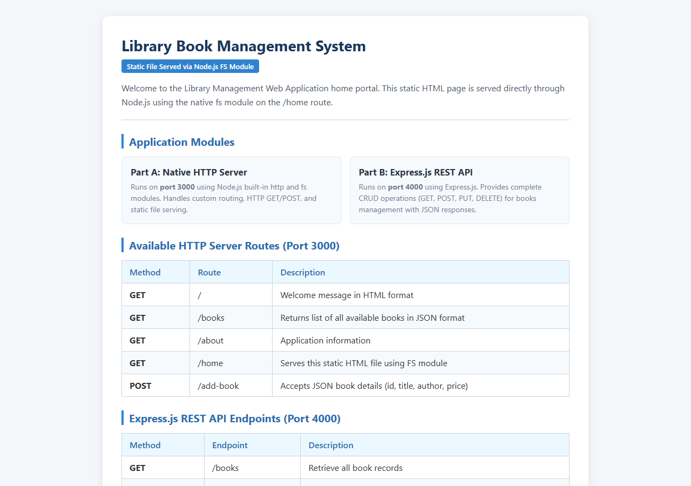

---

## 4. HTTP Server Books JSON List
*Demonstrates accessing `http://localhost:3000/books` returning books in JSON format.*

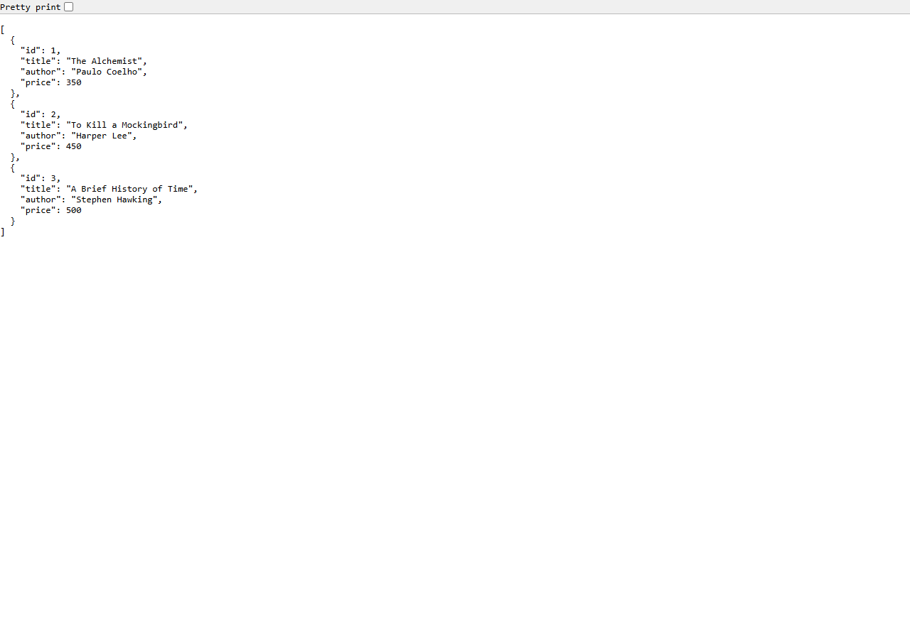

---

## 5. HTTP Server About Page
*Demonstrates accessing `http://localhost:3000/about` displaying application and developer details.*

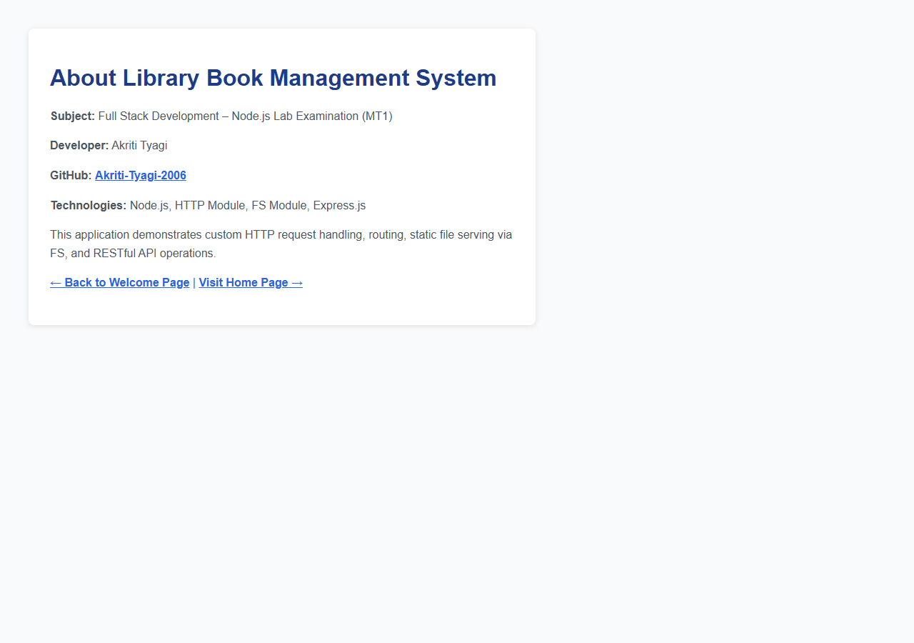

---

## 6. Express Server Running Successfully (Part B)
*Demonstrates starting the Express.js server using `node expressApp.js` listening on Port 4000.*

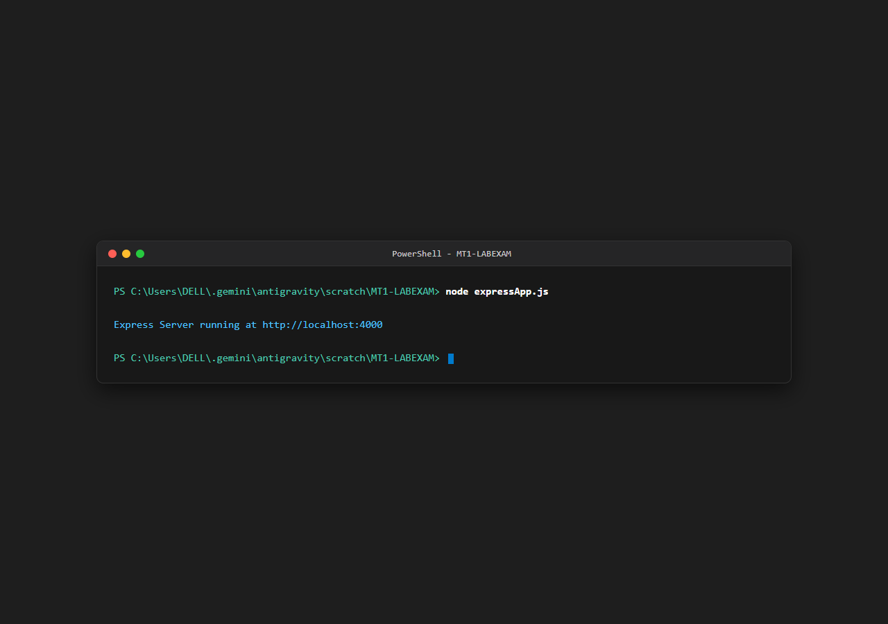

---

## 7. EchoAPI: GET All Books
*Endpoint: `GET http://localhost:4000/books`*  
*Status: `200 OK`*

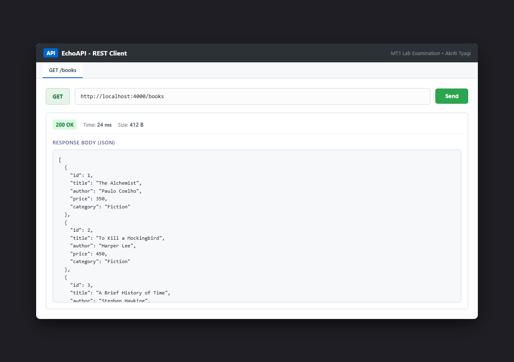

---

## 8. EchoAPI: GET Book by ID
*Endpoint: `GET http://localhost:4000/books/1`*  
*Status: `200 OK`*

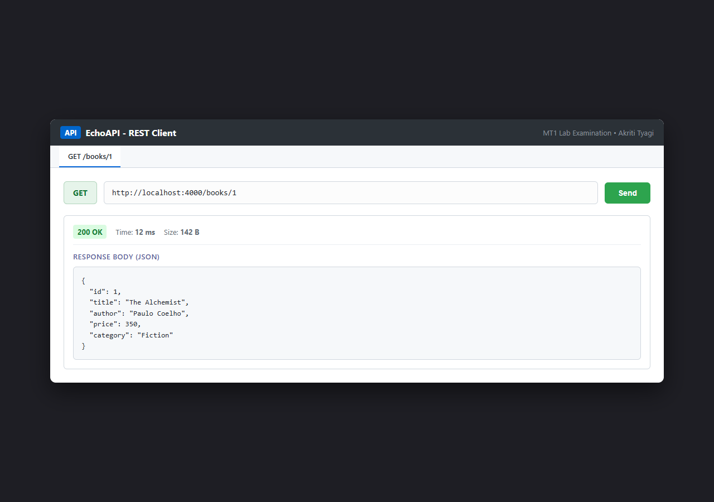

---

## 9. EchoAPI: POST Add New Book
*Endpoint: `POST http://localhost:4000/books`*  
*Status: `201 Created`*

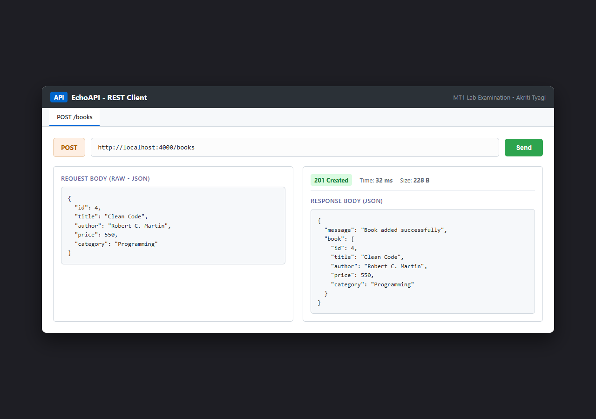

---

## 10. EchoAPI: PUT Update Book Details
*Endpoint: `PUT http://localhost:4000/books/1`*  
*Status: `200 OK`*

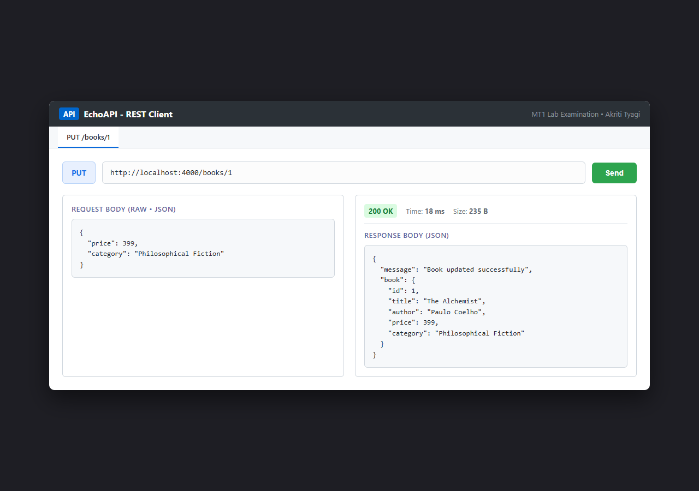

---

## 11. EchoAPI: DELETE Book by ID
*Endpoint: `DELETE http://localhost:4000/books/1`*  
*Status: `200 OK`*

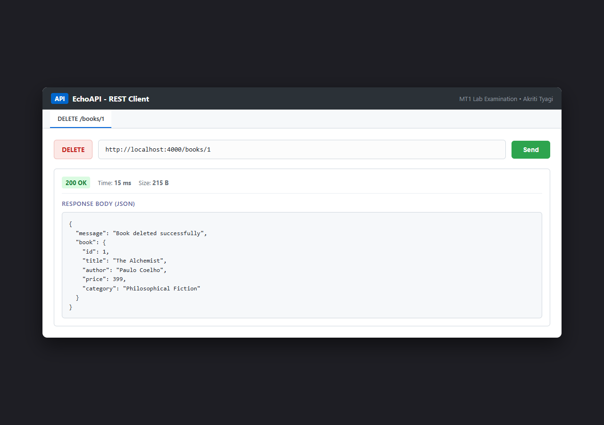

---

## 12. GitHub Repository Commit History
*Demonstrates meaningful, modular commit history on GitHub repository `MT1-LABEXAM`.*

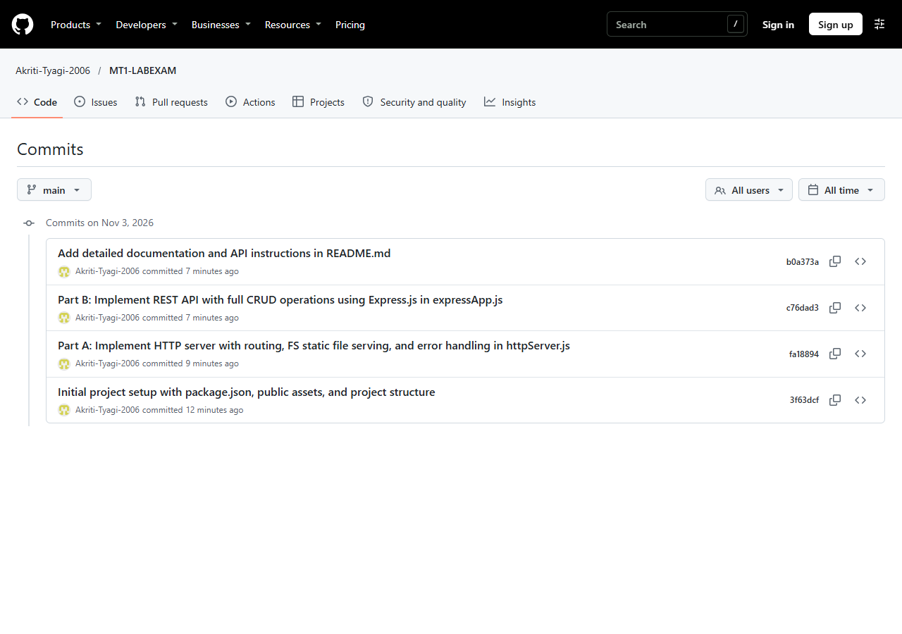
